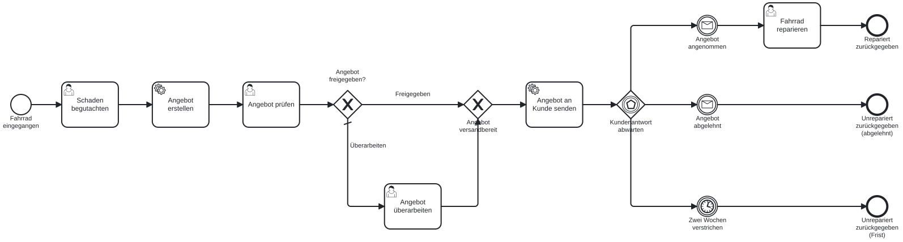

# Fahrradreparatur mit Quarkus und Camunda 8

Ein bewusst kleines, ausführbares Beispiel für eine Prozessanwendung mit Quarkus und Camunda 8.



Das Szenario handelt von einem fiktiven Fahrrad-Verleih mit einer eigenen Fahrradreparaturwerkstatt.
Im Prozess bike-repair geben Kunden ihr beschädigtes Fahrrad ab, die Reparaturwerkstatt prüft den Schaden und erstellt ein Angebot.
Anschließend kann der Kunde das Angebot annehmen, dann wird das Fahrrad repariert.
Wenn der Kunde das Angebot ablehnt, wird das Fahrrad zurückgegeben.

## Voraussetzungen

* JDK 21, Docker mit Compose **2.24.4+**
* Maven-Wrapper lädt Maven 3.9.11. Node/npm sind nur für Modellvalidierung nötig.
* Folgende noch nicht veröffentlichte Bibliotheken müssen im lokalen Maven-Repository liegen:
  * `dev.bpm-crafters.process-engine-adapters:process-engine-adapter-camunda-platform-c8-quarkus:2026.09.2-SNAPSHOT`,
    [PR 296](https://github.com/bpm-crafters/process-engine-adapters-camunda-8/pull/296), Commit `812c8669ffef48b2f007a7c3d10f1bf96fffe5f0`.
  * `dev.bpm-crafters.process-engine-worker:process-engine-worker-quarkus:0.8.6-SNAPSHOT`,
    [PR 289](https://github.com/bpm-crafters/process-engine-worker/pull/289), Commit `03af4743d2da43e8fba5ba3753550a9d926a8e96`.
  * Die Abhängigkeiten verwenden process-engine-api 1.7. Die PR-Artefakte zuerst gemäß deren Build-Anleitung lokal installieren.

## Start

```bash
docker compose -f stack/compose.yaml up -d --wait
./mvnw clean install
java -jar target/quarkus-app/quarkus-run.jar
```

## Szenario ausführen

Über die REST API können die unterschiedlichen Prozess Schritte nacheinander ausgeführt werden.
Hierfür sind die entsprechenden Requests im `http/repair.http` Client hinterlegt.
Als Ausführungsumgebung muss das Profil `local` gewählt werden.

| Dienst | Adresse |
|---|---|
| Anwendungs-REST / OpenAPI / Health | `http://localhost:8080`, `/q/openapi`, `/q/health` |
| Camunda REST / gRPC | `http://localhost:8088` (Client-Basis ohne `/v2`) / `localhost:26500` |
| Operate | `http://localhost:8088/operate` |
| PostgreSQL | `localhost:5432`, Datenbank/Benutzer/Passwort jeweils `bikerepair` |
| SMTP / MailHog-Oberfläche | `localhost:1025` / `http://localhost:8025` |
